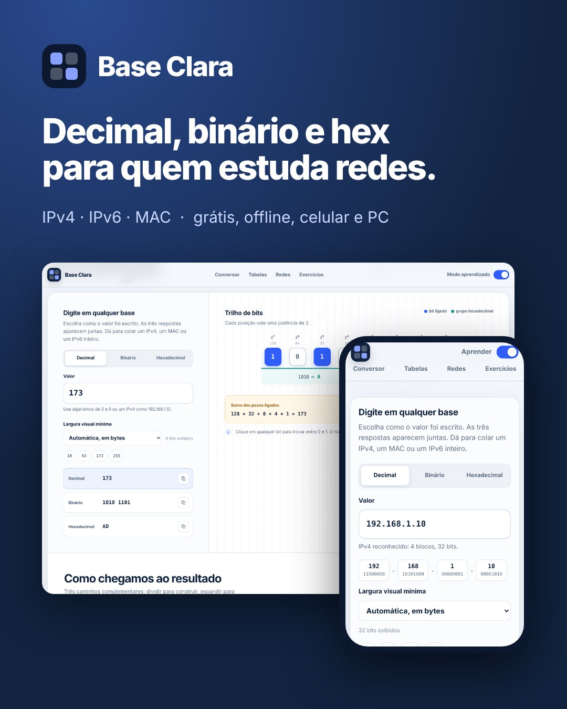

# Base Clara

Conversor e laboratório de bases numéricas: **decimal, binário e hexadecimal**, aplicado a endereços de rede (**IPv4, IPv6 e MAC**).

**Abrir o app:** https://willianbarbosadeandrade.github.io/network-labs/base-clara/

Gratuito, funciona offline e pode ser instalado no celular ou no computador.



## Por que fiz

Estudando a trilha da Cisco Networking Academy, percebi que muita dúvida de rede começa antes do protocolo: por que um octeto vai até 255, como uma máscara vira bits, por que o MAC é escrito em hexadecimal. Eu queria uma ferramenta que mostrasse a conversão acontecendo, e não só o resultado.

## O que faz

- **Converte nas três bases ao mesmo tempo**, com o trilho de bits interativo: clicar num bit liga ou desliga aquele peso.
- **Reconhece endereços colados inteiros**:
  - IPv4: `192.168.1.10`
  - MAC: `00:1A:2B:3C:4D:5E`, `00-1A-2B-3C-4D-5E` ou o formato Cisco `001a.2b3c.4d5e`
  - IPv6 completo ou comprimido: `2001:db8::ff00:42:8329`
- **Mostra o passo a passo**: divisões sucessivas, expansão por potências e grupos de 4 bits.
- **Tabelas de referência** de 0 a F e de 00 a FF, com busca.
- **Exercícios** de conversão e de situações de rede, com pistas e explicação quando a resposta está errada.
- **Modo conversão rápida**, que esconde as explicações para quem só quer o resultado.

## Instalar como app

| Aparelho | Como |
|---|---|
| Android, Windows, Linux, Mac (Chrome ou Edge) | botão **Instalar Base Clara** na página ou ícone de instalar na barra de endereço |
| iPhone e iPad (Safari) | **Compartilhar → Adicionar à Tela de Início** |
| Mac (Safari) | **Arquivo → Adicionar ao Dock** |

Depois de instalado, abre sem internet. Nenhum valor digitado sai do aparelho.

## Como foi feito

HTML, CSS e JavaScript puro, sem bibliotecas nem build.

```
base-clara/
├── index.html
├── css/estilos.css
├── js/conversao.js      regras de conversão (sem DOM, testáveis no Node)
├── js/app.js            interface
├── sw.js                cache para funcionar offline
├── manifest.webmanifest dados para instalar como app
└── testes/conversao.test.js
```

Algumas decisões:

- **BigInt em todas as contas.** Um IPv6 tem 128 bits, e o `Number` do JavaScript só é exato até 2^53.
- **Regras separadas da interface.** `conversao.js` não toca na página, então dá para testar no terminal.
- **Service worker com cache primeiro.** O app abre instantâneo e continua funcionando sem rede.

## Testes

```bash
node --test base-clara/testes/conversao.test.js
```

Os testes cobrem as conversões nas três bases, IPv4, MAC (três formatos), IPv6 completo e comprimido, os limites e as mensagens de erro.

---

Feito por **Willian Barbosa** · [LinkedIn](https://www.linkedin.com/in/willian-barbosa-de-andrade-31a068226) · [network-labs](https://github.com/willianbarbosadeandrade/network-labs)
